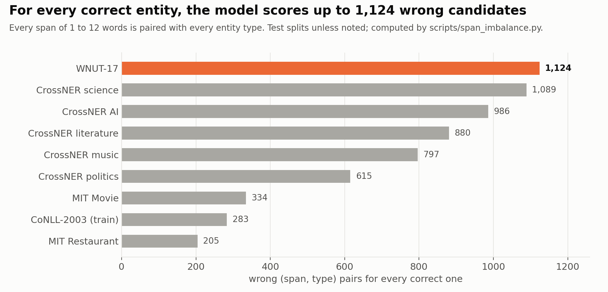
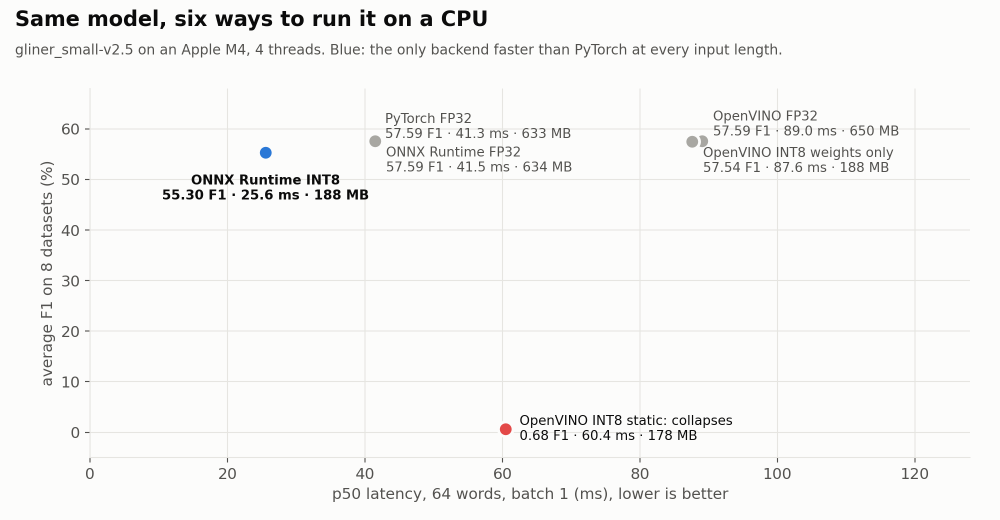

# GLiNER-Robust

**A fork of GLiNER that tests whether imbalance losses help zero-shot NER, and what quantization really costs on a CPU.**

---

**GLiNER** finds entities of any type you name ("person", "programming language", "dish") in text, without being
trained on that type: this is *zero-shot* NER. This fork adds two training losses, an evaluation setup over 8
datasets, and a benchmark of 6 ways to run the model on a CPU.

## In short

| | |
|:---:|:---|
| **1,124** | Wrong candidates scored for every correct entity on WNUT-17. That imbalance is why imbalance losses were tried. |
| **BCE in disguise** | The first "Dice" results were plain BCE runs: the Dice option didn't exist yet. They were withdrawn. |
| **1.62×** faster | ONNX Runtime INT8 at 64 words, 3.4× smaller, for −2.29 F1. |
| **0.68** F1 | What OpenVINO's static INT8 leaves of a 57.59 F1 model. Root cause still unknown. |

  

---

## How it started

GLiNER kept missing rare entities, and the loss looked like a suspect. A span model scores every span of 1 to 12 words
against every entity type, so almost every (span, type) pair is a negative. Counting them with
`scripts/span_imbalance.py` gave 283 negatives per positive on the CoNLL-2003 training set and 1,124 on WNUT-17.

With **BCE** (binary cross-entropy, a yes/no score for each pair), most of the training signal goes to easy negatives.
Two losses are built for this: **focal loss** turns down the weight of easy examples, and **Dice loss** scores the
overlap between predicted and true entities, so easy negatives barely count.

## The first results were BCE in disguise

The first check: GLiNER's focal loss defaults (α = −1, γ = 0) make it exactly BCE, so "focal" had never really been
on. Then came a first ablation table, where Dice and Dice + width weighting gave exactly the same score.

> Identical to the second decimal was too clean to be true.

The training script passed `loss_type` and `use_span_width_weight` to options that didn't exist, and the package had
no Dice loss at all. The logs of both "Dice" runs showed identical loss curves, on the scale of a summed BCE, while a
Dice loss stays between 0 and 1. They were BCE runs, with 1 seed, 200 steps and one test set. The whole table was
withdrawn ([`docs/devlog.md`](docs/devlog.md)).

Dice loss and span-width weighting were then written into the package, with tests. The defaults reproduce upstream
exactly. On the way, an upstream bug was fixed: `BiEncoderSpanModel` passed `label_smoothing` into the `prob_margin`
argument.

## A trustworthy baseline first

Before comparing losses, the baseline had to be trustworthy:

- 8 zero-shot datasets (5 CrossNER domains, MIT Movie, MIT Restaurant, WNUT-17), pinned with checksums.
- Entity-level F1 identical to GLiNER's own evaluator, with 95% intervals from 10,000 bootstrap resamples.

The base model (`gliner_small-v2.5`) averages **57.59 F1**. Its errors are telling: on WNUT-17, precision is 36.5 and
recall 64.5, because the model tags common nouns like "soldier" or "army" that annotators left out. Vague types score
badly: `miscellaneous` reaches 11.8 F1 on CrossNER AI.

## The bug that blocked OpenVINO

Exporting the model to OpenVINO failed: the ONNX graph had six `If` nodes from DeBERTa's position code, and OpenVINO's
CPU plugin refused them ("If operation with dynamic rank"). In GLiNER, attention is always self-attention, so that
branch is never taken.

The fix replaces the helper with its taken branch, during export only. The patched and original graphs give identical
outputs (max difference 0.0), and a test checks it on a tiny random DeBERTa.

---

## Same model, six ways to run it

  

- **ONNX Runtime INT8** is the only backend faster than PyTorch at every input length: 2.84× at 16 words, 1.62× at
  64. It is 3.4× smaller and costs 2.29 F1, unevenly across datasets.
- **OpenVINO INT8 weights only** loses nothing (−0.05 F1, the interval includes 0), but every OpenVINO backend is slower
  than PyTorch on Apple silicon. OpenVINO is built for Intel CPUs, so this says nothing about them.
- **OpenVINO static INT8** (weights and activations) collapses to 0.68 F1. Keeping the heads, the LSTM and the
  scoring step in FP32 doesn't fix it.

## What didn't work

- **The first loss ablation**, withdrawn (see above).
- **OpenVINO static INT8**: the cause of the collapse is still unknown.
- **OpenVINO on an M4**: 2.1× slower than PyTorch at 64 words, even when lossless.

## Lessons

- **Count the imbalance before changing the loss.** The 1,124 came from a script, not a guess.
- **Identical scores are a red flag.** Check that the change actually ran, in the logs.
- **One seed can't support a one-point gain.**
- **Compare an exported model output by output**, before looking at F1.

## Next

- Run the full loss ablation: 7 variants × 5 seeds, fine-tuned on CoNLL-2003, scored on the 8 datasets. The code and
  configs are ready.
- Run static INT8 and OpenVINO on an Intel CPU, the hardware it targets.
- A per-type F1 breakdown, to see whether the losses help rare types.

---

All numbers come from files in `results/`; [RUNBOOK.md](RUNBOOK.md) regenerates them. Fork of
[GLiNER](https://github.com/urchade/GLiNER), Apache-2.0 (`LICENSE`).
